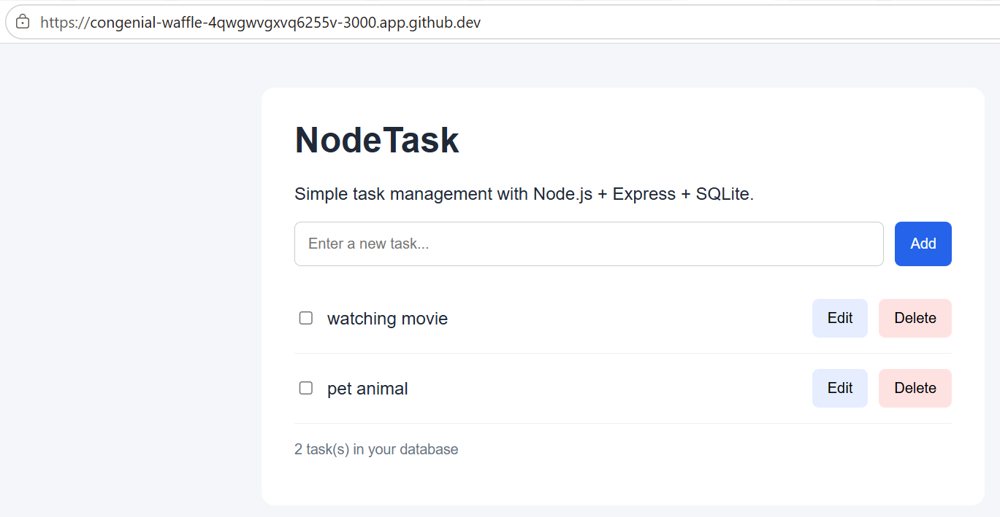

# Hello Node.js

A collection of learning projects, experiments, and explorations using **Node.js** and its ecosystem.

This repository documents my journey into backend development, web development, APIs, databases, and modern JavaScript technologies.

---

## Projects

### 01. NodeTask — Simple Task Manager



A simple CRUD (Create, Read, Update, Delete) application built using Node.js, Express.js, and SQLite.

**Features**
- Create new tasks
- View all tasks
- Edit existing tasks
- Mark tasks as completed
- Delete tasks
- Persist data using SQLite

**Technology Stack**

| Component | Technology |
|---|---|
| Runtime | Node.js |
| Backend | Express.js |
| Frontend | HTML, CSS, JavaScript |
| Database | SQLite |
| Database Driver | better-sqlite3 |
| Development Environment | GitHub Codespaces |

**Project Statistics**

| Metric | Details |
|---|---|
| Source/configuration files | 3 |
| Database files | 1 (generated automatically) |
| Approximate LOC | 250–270 |
| Architecture | Client–Server |
| API | REST |
| Operations | CRUD |
| Difficulty | Beginner |

**Project Structure**

```text
nodetask/
├── package.json
├── server.js
├── tasks.db
└── public/
    └── index.html
```

**Run Locally**

```bash
cd nodetask
npm install
npm start
```

Open: `http://localhost:3000`

[Explore NodeTask Source Code](./nodetask)

---

## Learning Objectives

- Understand Node.js and JavaScript runtime concepts.
- Build web servers using Express.js.
- Understand HTTP methods, routing, and REST APIs.
- Implement CRUD operations.
- Connect applications to SQLite databases.
- Practise Git, GitHub, and cloud-based development.

---

## Development Environment

- GitHub
- GitHub Codespaces
- Visual Studio Code
- Node.js
- Express.js
- SQLite

---

*Learning by building, one project at a time.*
